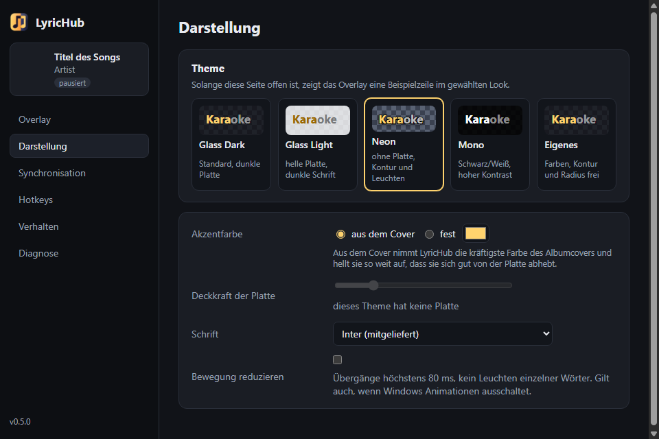

# LyricHub

[English](README.md) · **Deutsch**

Windows-Overlay, das den laufenden Spotify-Song und karaoke-artig mitlaufende Lyrics über Spielen anzeigt, synchron zum hörbaren Ton. Der vollständige Plan steht in [PLAN.md](PLAN.md) (englisch: [PLAN.en.md](PLAN.en.md)).

[](https://youtu.be/lT9tKeel5nE)

▶ [Promovideo auf YouTube ansehen](https://youtu.be/lT9tKeel5nE) (5:47, englisch). Es ist mit Remotion im Code entstanden; das Projekt liegt in [promo-video/](promo-video/).

Stand: `v1.0.0`, das erste öffentliche Release (2026-10-26). Das Overlay zeigt die synchronen Lyrics des laufenden Spotify-Songs von [LRCLIB](https://lrclib.net) mit einer Karaoke-Füllung, die Wort für Wort läuft, dazu Cover, Titel und Artist; Position und Größe lassen sich im Edit-Modus direkt am Bildschirm einstellen. Vier Layouts, fünf Themes mit Akzentfarbe aus dem Albumcover, Deutsch und Englisch. Das Overlay bleibt auch über Spielen oben, die sich selbst nach vorne setzen, und lässt sich auf Vollbild-Apps beschränken. Korrekturen gelten pro Song, Ausgabegeräte haben eigene Offsets, und ein Kalibrier-Assistent und das Sync Lab helfen beim Einstellen. Japanische Zeilen lassen sich in Romaji anzeigen ([docs/romaji.md](docs/romaji.md)). Ergebnisse in [docs/phase5.md](docs/phase5.md) und die Sicherheits-, Performance- und Speicherplatz-Prüfungen in [docs/checks.md](docs/checks.md), [docs/phase4.md](docs/phase4.md), [docs/phase3.md](docs/phase3.md) mit dem Messbericht [docs/sync-report.md](docs/sync-report.md), dazu [docs/phase2.md](docs/phase2.md) und [docs/phase1.md](docs/phase1.md), die Spikes aus Phase 0 in [docs/spike-smtc.md](docs/spike-smtc.md) und [docs/spike-overlay.md](docs/spike-overlay.md).


| | |
|---|---|
|  |  |
|  |  |

Die Bilder zeigen Beispielzeilen; Liedtexte stehen nicht im Repository.

## Hinweis: vibe-coded

LyricHub ist mit KI entstanden („vibe coding“). Den Plan hat Claude Fable geschrieben, den Code Claude Opus 5.5 in Claude Code, Phase für Phase. Ein Mensch hat die Richtung vorgegeben, die Ergebnisse am eigenen PC getestet und jede Phase abgenommen, den Code aber nicht Zeile für Zeile geprüft. Es gibt keine Gewährleistung; Nutzung auf eigene Gefahr.

Wer den fertigen Dateien nicht traut, kann alles selbst nachvollziehen oder nachbauen:

- [docs/original-plan/](docs/original-plan/): der Plan, wie er vor der ersten Codezeile geschrieben wurde (Deutsch und Englisch). Mit ihm lässt sich LyricHub von Grund auf neu bauen, mit einem KI-Assistenten oder von Hand.
- [PLAN.md](PLAN.md) / [PLAN.en.md](PLAN.en.md): derselbe Plan mit allen späteren Entscheidungen und dem Ergebnis jeder Phase.
- [docs/](docs/) (englisch: [docs/en/](docs/en/)): Berichte jeder Phase mit Messwerten und Abweichungen vom Plan.
- Der gesamte Code steht hier; der Installer lässt sich mit `npx tauri build` selbst bauen (siehe unten).

## Installieren

`LyricHub_<version>_x64-setup.exe` unter [Releases](https://github.com/HeiligerHoly/LyricHub/releases) herunterladen und ausführen (selbst bauen siehe unten: `npx tauri build`, Ergebnis unter `src-tauri/target/release/bundle/nsis/`). Der Installer richtet LyricHub nur für den aktuellen Benutzer ein und braucht keine Administratorrechte. Er ist nicht signiert: Windows SmartScreen meldet einen unbekannten Herausgeber, „Weitere Informationen“ → „Trotzdem ausführen“. Fehlt die WebView2 Runtime (auf Windows 11 vorhanden), lädt der Installer sie nach. Danach Spotify starten; LyricHub erscheint im Tray und zeigt den laufenden Song.

## Voraussetzungen zum Bauen

- Windows 11 (getestet); Windows 10 ab Version 2004 ist nicht getestet
- Node.js 20 oder neuer
- Rust (stable, MSVC-Toolchain) über rustup
- Visual Studio Build Tools mit C++-Workload und Windows SDK
- WebView2 Runtime (auf Windows 11 vorinstalliert)
- Spotify-Desktop-App (Store- oder Desktop-Version); ein Spotify-Login in LyricHub ist nicht nötig

Build Tools installieren (fragt einmal per UAC nach Admin-Rechten):

```powershell
winget install --id Microsoft.VisualStudio.2022.BuildTools -e --override "--passive --wait --norestart --add Microsoft.VisualStudio.Workload.VCTools --includeRecommended"
```

## Entwickeln

```powershell
npm install
npm run tauri dev      # App mit Hot-Reload
npm run check          # Svelte/TypeScript prüfen
npx tauri build        # Release-Build und Installer (NSIS)
```

Die App startet im Tray. Linksklick auf das Tray-Icon blendet das Overlay ein und aus, das Rechtsklick-Menü öffnet den Edit-Modus und die Einstellungen. Das Einstellungsfenster existiert nur, solange es offen ist. Mit `--minimized` (so startet der Autostart) öffnet sich kein Fenster.

Standard-Kürzel; alle acht globalen lassen sich unter Einstellungen → Hotkeys ändern oder abschalten:

| Kürzel | Funktion |
|---|---|
| Strg+Alt+L | Overlay ein/aus |
| Strg+Alt+E | Edit-Modus: Overlay ziehen, an den Ecken skalieren, an den Seiten die Breite ändern |
| Enter / Esc | im Edit-Modus speichern / abbrechen (fest, nur dann registriert) |
| Strg+Alt+K | Layout wechseln (Karaoke, Leiste, Stapel, Minimal) |
| Strg+Alt+R | Japanische Zeilen in Romaji (Hepburn) und zurück |
| Strg+Alt+, / Strg+Alt+. | Lyrics des laufenden Songs 100 ms früher / später; LyricHub merkt sich den Wert pro Song |
| Strg+Alt+Umschalt+, / Strg+Alt+Umschalt+. | dasselbe in 25-ms-Schritten |
| Leertaste / Esc | während Kalibrierung oder Sync-Protokoll: Tap beim hörbaren Zeilenbeginn / Messung beenden (fest, nur dann registriert) |

Das Spiel behält im Edit-Modus den Fokus; das Overlay nimmt nie Tastatureingaben an. Setzt sich ein Spiel über das Overlay, holt LyricHub es sofort zurück (Ereignisse der Fensterreihenfolge, keine Injection); gelingt das nicht, nennt der Tray das verdeckende Fenster. „Nur bei Vollbild-App zeigen“ (Einstellungen → Overlay) zeigt das Overlay nur, solange ein Spiel oder Video im Vollbild läuft (randlos oder exklusiv), und blendet es aus, sobald ein normales Fenster oder der Desktop vorne ist; Edit-Modus und Vorschau der Darstellung bleiben sichtbar. In einem getesteten Spiel war das Overlay auch im exklusiven Vollbild zu sehen; verdeckt ein Spiel es trotzdem, zeigt der Tray einen Hinweis, und der Modus „Randloses Fenster“ im Spiel hilft. Pausiert Spotify, wird das Overlay nach 2 s gedimmt und nach 10 s ausgeblendet („Bei Pause ausblenden nach“ unter Einstellungen → Overlay, 0 = nie).

Darstellung (Einstellungen → Darstellung): Themes Glass Dark, Glass Light, Neon, Mono und ein eigenes; Akzentfarbe aus dem Cover (mit Kontrastprüfung gegen die Platte) oder fest; Deckkraft, Schrift (Inter ist mitgeliefert) und „Bewegung reduzieren“. Solange die Seite offen ist, zeigt das Overlay Beispielzeilen im gewählten Look. Die Sprache (System, Deutsch, Englisch) steht unter Verhalten.

Offsets (Einstellungen → Synchronisation) addieren sich, positiv heißt Lyrics später: **Gerät** für die Ausgabelatenz (jedes Ausgabegerät hat einen eigenen Wert, Bluetooth startet mit +150 ms), **Song** für LRC-Dateien, die zu früh oder zu spät liegen (per Nudge), und **global** als Reserve. Der Kalibrier-Assistent schlägt aus fünf Taps einen Geräte-Offset vor. Das Sync-Protokoll misst über beliebig viele Songs und schreibt Median, p95 und Tendenz pro Song nach `logs\sync-protocol-<unix>.json`. Das Sync Lab unter Einstellungen → Diagnose zeigt die Positionsberichte der letzten 60 s und exportiert sie als JSON.

Einstellungen liegen in `%APPDATA%\LyricHub\settings.json`, Lyrics-Cache sowie Song- und Geräte-Offsets in `%APPDATA%\LyricHub\lyrichub.db`, Logs unter `%APPDATA%\LyricHub\logs`. Das Log-Level steuert `LYRICHUB_LOG` (z. B. `debug`). Die Logs enthalten keine Liedtexte.

## Tests und Spikes

```powershell
# Spike A: Spotify-Timeline über die Windows-Media-Session messen
powershell -NoProfile -ExecutionPolicy Bypass -File tools\smtc-probe\smtc-probe.ps1 -DurationSec 360
python tools\smtc-probe\analyze.py docs\spike-smtc.csv

# Spike B: App bauen und Overlay-Selbsttest in drei Szenarien
powershell -NoProfile -ExecutionPolicy Bypass -File tools\overlay-spike\run-spike.ps1

# CPU und Speicher einer laufenden LyricHub-Instanz messen
powershell -NoProfile -ExecutionPolicy Bypass -File tools\overlay-spike\measure-cpu.ps1 -Seconds 10

# Start ohne Fokusklau (Release-Build, LyricHub darf nicht laufen)
powershell -NoProfile -ExecutionPolicy Bypass -File tools\overlay-spike\start-focus-test.ps1

# Edit-Modus über dem Fake-Game prüfen (laufende Instanz nötig, bewegt die Maus einige Sekunden)
powershell -NoProfile -ExecutionPolicy Bypass -File tools\overlay-spike\edit-mode-test.ps1

# Layouts der Overlay-Seite während der Wiedergabe zählen ("kein Layout pro Frame"); LyricHub dafür mit
# Debug-Port starten, in Git Bash: WEBVIEW2_ADDITIONAL_BROWSER_ARGUMENTS=--remote-debugging-port=9223 src-tauri/target/debug/lyrichub.exe --minimized
node tools\overlay-spike\layout-count.mjs 30

# Seek-Latenz bis zum gezeichneten Overlay (laufende Instanz und Spotify nötig, spult im aktuellen Song)
powershell -NoProfile -ExecutionPolicy Bypass -File tools\sync\seek-test.ps1 -Count 5

# Nudge pro Song über einen echten Songwechsel (springt einen Song vor und zurück)
powershell -NoProfile -ExecutionPolicy Bypass -File tools\sync\nudge-test.ps1
```

93 Rust-Unit-Tests (LRC-Parser, geschätzte Wortzeiten, Playback-Clock mit Quellen-Fusion, Offsets, Tap-Auswertung, Matcher, LRCLIB-Client gegen aufgezeichnete Antworten, Cache, Geometrie, Settings-Store mit Migration, SMTC-Songwechsel-Erkennung, Werbung und Podcasts, Kürzel): `cargo test` in `src-tauri`. Live-Anfragen an LRCLIB machen die Tests nicht.

## Hinweise

Lyrics sind urheberrechtlich geschützt. LyricHub zeigt sie nur an und verteilt sie nicht weiter. Quelle der Lyrics ist [LRCLIB](https://lrclib.net), eine von der Community gepflegte Datenbank; LyricHub fragt sie mit eigenem User-Agent an und speichert Ergebnisse lokal, um sie nicht bei jeder Wiederholung erneut abzufragen. Die Test-Fixtures im Repository enthalten erfundenen Text.

LyricHub ist nicht mit Spotify AB verbunden und wird von Spotify weder unterstützt noch gesponsert. Spotify ist eine Marke von Spotify AB.

## Lizenz

LyricHub ist quelloffen (source available) unter der MIT-Lizenz mit der Commons Clause ([LICENSE](LICENSE)). Jeder darf es nutzen, verändern und weitergeben, auch beim Streamen. Verkaufen ist nicht erlaubt, auch nicht als bezahlter Dienst, dessen Wert ganz oder im Wesentlichen aus LyricHub kommt.

Fremde Komponenten behalten ihre eigenen Lizenzen. Sie stehen in [THIRD_PARTY_NOTICES.md](THIRD_PARTY_NOTICES.md), die der Installer zusammen mit der Lizenz neben `lyrichub.exe` legt.
