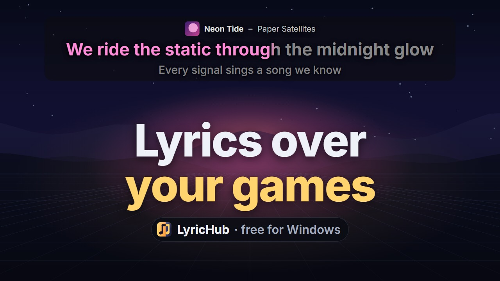
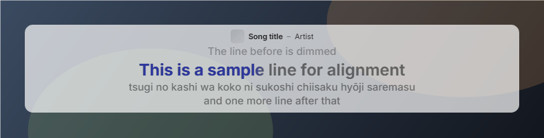
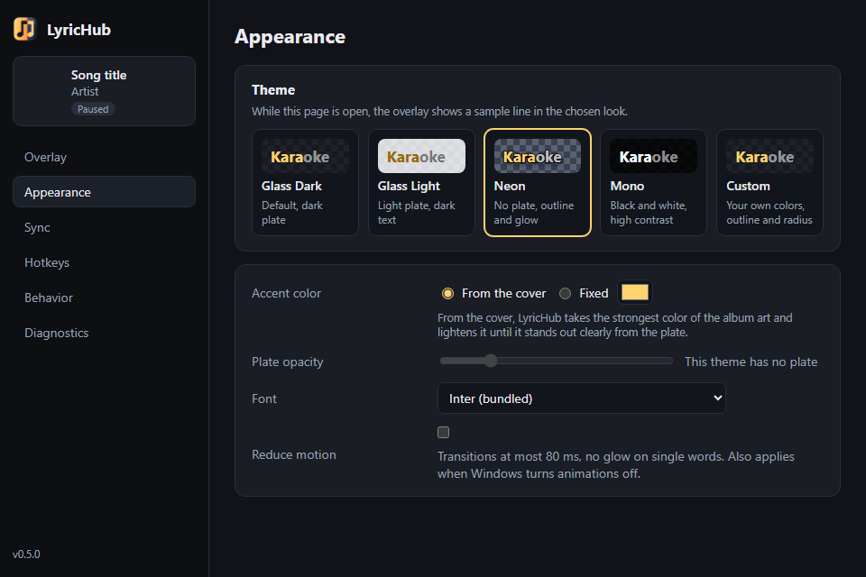
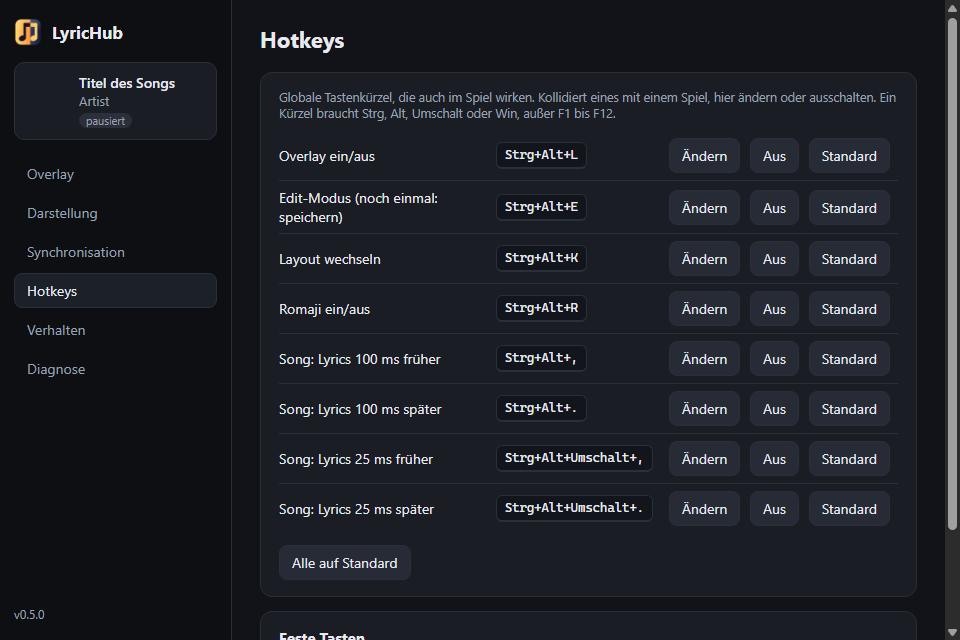

# LyricHub

**English** · [Deutsch](README.de.md)

Synced, karaoke-style lyrics of the song playing in Spotify, on top of your games. Free for Windows, no Spotify login.

[](https://youtu.be/lT9tKeel5nE)

**[Download the latest version](https://github.com/HeiligerHoly/LyricHub/releases/latest)** · [Promo video](https://youtu.be/lT9tKeel5nE) (5:47) · [FAQ](docs/en/faq.md) · [Support on Ko-fi](https://ko-fi.com/heiliger)

> **Vibe-coded and source available.** AI wrote the plan and the code; a human tested and signed off every phase (see the [disclaimer](#disclaimer-vibe-coded)). Free to use and share, not for sale ([license](#license)). The full plan is in [PLAN.en.md](PLAN.en.md) (German original: [PLAN.md](PLAN.md)).

## Features

- Synced lyrics of the current Spotify song from [LRCLIB](https://lrclib.net), with a karaoke fill that moves word by word (can be turned off: the word times are mostly estimated), plus cover, title and artist.
- Position and size are set right on the screen in the edit mode.
- Four layouts and five themes, with an accent colour taken from the album cover.
- Stays on top even over games that push themselves to the front, and can be limited to fullscreen apps.
- Corrections are kept per song, every output device has its own offset, and a calibration assistant and the Sync Lab help with the setup.
- Japanese lines can be shown in romaji ([docs/en/romaji.md](docs/en/romaji.md)).
- Experimentally, a browser can be the player instead of Spotify (YouTube Music, YouTube, the Spotify web player).
- Optional plugin **Align**: real word times from the player's sound instead of the estimate, computed after the song while no game runs fullscreen ([docs/en/plugins.md](docs/en/plugins.md)).
- German and English interface. It follows the Windows display language and can be switched under Settings → Behavior → Language.

Current version: `1.2.0` (2026-10-29), with the plugin Align. Changes are in [CHANGELOG.md](CHANGELOG.md). The promo video was made in code with Remotion; the project is in [promo-video/](promo-video/).


| | |
|---|---|
|  |  |
|  |  |

The pictures show sample lines; the repository contains no song lyrics.

## Disclaimer: vibe-coded

LyricHub was built with AI ("vibe coding"). Claude Fable wrote the plan, and Claude Opus 5.5 wrote the code in Claude Code, phase by phase. A human set the direction, tested the results on their own PC and signed off each phase, but did not review the code line by line. There is no warranty; use it at your own risk.

If you do not trust the binaries, you can follow or rebuild everything yourself:

- [docs/original-plan/](docs/original-plan/): the plan as it was written before the first line of code (German and English). With it you can build LyricHub from scratch, with an AI assistant or by hand.
- [PLAN.en.md](PLAN.en.md) / [PLAN.md](PLAN.md): the same plan with all later decisions and the result of each phase.
- [docs/en/](docs/en/) (German: [docs/](docs/)): the report of each phase, with measurements and deviations from the plan.
- Results and checks: [phase 5](docs/en/phase5.md), the security, performance and disk checks in [docs/en/checks.md](docs/en/checks.md), the sync measurement in [docs/en/sync-report.md](docs/en/sync-report.md), the phases [4](docs/en/phase4.md), [3](docs/en/phase3.md), [2](docs/en/phase2.md) and [1](docs/en/phase1.md), the phase 0 spikes [SMTC](docs/en/spike-smtc.md) and [overlay](docs/en/spike-overlay.md), and the [browser spike](docs/en/spike-browser.md) for v1.1.
- All of the code is here; build the installer yourself with `npx tauri build` (see below).

## Install

Download `LyricHub_<version>_x64-setup.exe` from the [releases](https://github.com/HeiligerHoly/LyricHub/releases) and run it (to build it yourself, see below: `npx tauri build`, output in `src-tauri/target/release/bundle/nsis/`). The installer sets LyricHub up for the current user only and needs no administrator rights. It is not signed: Windows SmartScreen reports an unknown publisher; choose "More info" → "Run anyway". If the WebView2 Runtime is missing (Windows 11 has it), the installer fetches it. Then start Spotify; LyricHub sits in the tray and shows the current song.

The plugin Align is a separate download, `lyrichub-align-<version>.zip` in the same release; install it under Settings → Plugins ([docs/en/plugins.md](docs/en/plugins.md)).

## Requirements for building

- Windows 11 (tested); Windows 10 from version 2004 is not tested
- Node.js 20 or newer
- Rust (stable, MSVC toolchain) via rustup
- Visual Studio Build Tools with the C++ workload and the Windows SDK
- WebView2 Runtime (preinstalled on Windows 11)
- Spotify desktop app (Microsoft Store or desktop version); LyricHub needs no Spotify login. Experimental since 1.1: YouTube Music in a browser, regular YouTube and the Spotify web player in Edge

Install the Build Tools (asks once for administrator rights through UAC):

```powershell
winget install --id Microsoft.VisualStudio.2022.BuildTools -e --override "--passive --wait --norestart --add Microsoft.VisualStudio.Workload.VCTools --includeRecommended"
```

## Development

```powershell
npm install
npm run tauri dev      # app with hot reload
npm run check          # check Svelte/TypeScript
npx tauri build        # release build and installer (NSIS)
```

Published releases are built with `toolsuild-release.ps1`: it builds the installer and the align plugin ZIP, replaces the Cargo home folder in the source paths Rust embeds for panic messages, and checks that no path with a local user folder is left in the executables.

The app starts in the tray. A left click on the tray icon shows or hides the overlay; the right-click menu opens the edit mode and the settings. The settings window only exists while it is open. With `--minimized` (as the autostart uses it) no window opens.

Default shortcuts; all eight global ones can be changed or turned off under Settings → Hotkeys:

| Shortcut | Action |
|---|---|
| Ctrl+Alt+L | Overlay on/off |
| Ctrl+Alt+E | Edit mode: drag the overlay, scale at the corners, change the width at the sides |
| Enter / Esc | In the edit mode: save / cancel (fixed, registered only then) |
| Ctrl+Alt+K | Switch layout (Karaoke, Bar, Stack, Minimal) |
| Ctrl+Alt+R | Japanese lines in romaji (Hepburn) and back |
| Ctrl+Alt+, / Ctrl+Alt+. | Lyrics of the current song 100 ms earlier / later; LyricHub keeps the value per song |
| Ctrl+Alt+Shift+, / Ctrl+Alt+Shift+. | The same in 25 ms steps |
| Space / Esc | During calibration or the sync log: tap at each line start you hear / end the measurement (fixed, registered only then) |

The game keeps the focus in the edit mode; the overlay never takes keyboard input. If a game moves over the overlay, LyricHub puts it back on top at once (window-order events, no injection); if that fails, the tray names the covering window. "Only with a fullscreen app" (Settings → Overlay) shows the overlay only while a game or video runs fullscreen (borderless or exclusive) and hides it as soon as a normal window or the desktop is in front; the edit mode and the appearance preview stay visible. In a tested game the overlay was also visible in exclusive fullscreen; if a game hides it anyway, the tray shows a hint, and the game's borderless window mode helps. When Spotify pauses, the overlay dims after 2 s and fades out after 10 s ("Hide when paused after" under Settings → Overlay, 0 = never).

Appearance (Settings → Appearance): themes Glass Dark, Glass Light, Neon, Mono and a custom one; accent colour from the cover (checked for contrast against the plate) or fixed; opacity, font (Inter is bundled) and "Reduce motion". While the page is open, the overlay shows sample lines in the chosen look.

Offsets (Settings → Sync) add up; positive means lyrics later: **device** for the output latency (every output device has its own value, Bluetooth starts at +150 ms), **song** for LRC files that are early or late (by nudging), and **global** as a reserve. The calibration assistant suggests a device offset from five taps. The sync log measures over any number of songs and writes median, p95 and bias per song to `logs\sync-protocol-<unix>.json`. The Sync Lab under Settings → Diagnostics shows the position reports of the last 60 s and exports them as JSON.

Settings live in `%APPDATA%\LyricHub\settings.json`; the lyrics cache and the song and device offsets in `%APPDATA%\LyricHub\lyrichub.db`; logs under `%APPDATA%\LyricHub\logs`. `LYRICHUB_LOG` sets the log level (e.g. `debug`). The logs contain no lyrics.

## Tests and spikes

```powershell
# Spike A: measure the Spotify timeline through the Windows media session
powershell -NoProfile -ExecutionPolicy Bypass -File tools\smtc-probe\smtc-probe.ps1 -DurationSec 360
python tools\smtc-probe\analyze.py docs\spike-smtc.csv

# List every media session Windows knows, for example to find a browser's session ID for -AppFilter
powershell -NoProfile -ExecutionPolicy Bypass -File tools\smtc-probe\list-sessions.ps1

# Spike B: build the app and run the overlay self-test in three scenarios
powershell -NoProfile -ExecutionPolicy Bypass -File tools\overlay-spike\run-spike.ps1

# CPU and memory of a running LyricHub instance
powershell -NoProfile -ExecutionPolicy Bypass -File tools\overlay-spike\measure-cpu.ps1 -Seconds 10

# Start without taking the focus (release build; LyricHub must not be running)
powershell -NoProfile -ExecutionPolicy Bypass -File tools\overlay-spike\start-focus-test.ps1

# Edit mode over the fake game (needs a running instance, moves the mouse for a few seconds)
powershell -NoProfile -ExecutionPolicy Bypass -File tools\overlay-spike\edit-mode-test.ps1

# Count layouts of the overlay page during playback ("no layout per frame"); start LyricHub with
# a debug port for it, in Git Bash: WEBVIEW2_ADDITIONAL_BROWSER_ARGUMENTS=--remote-debugging-port=9223 src-tauri/target/debug/lyrichub.exe --minimized
node tools\overlay-spike\layout-count.mjs 30

# Seek latency until the overlay has drawn (needs a running instance and Spotify, seeks in the current song)
powershell -NoProfile -ExecutionPolicy Bypass -File tools\sync\seek-test.ps1 -Count 5

# Nudge per song across a real track change (skips one song forward and back)
powershell -NoProfile -ExecutionPolicy Bypass -File tools\sync\nudge-test.ps1
```

114 Rust unit tests (LRC parser, estimated word times, playback clock with source fusion, offsets, tap evaluation, matcher, LRCLIB client against recorded answers, cache, geometry, settings store with migration, SMTC track-change detection, browser titles, ads and podcasts, shortcuts with AltGr detection, plugin manifests, ZIP checks and processes, diagnostics export without song details): `cargo test` in `src-tauri`. The tests make no live requests to LRCLIB. Six more run with `cargo test -- --ignored`: one needs a desktop session, one measures the word timing estimate against the JamendoLyrics dataset ([docs/en/word-timing.md](docs/en/word-timing.md)), and four run the plugin host against the example plugin in `plugins/example`, which they build first.

The align plugin in `plugins/align` has 29 tests of its own (`cargo test` there): resampler, features and CTC path against reference values from torchaudio and transformers (`tests/make_golden.py`, synthetic sound), text targets, windows, the recorder and the status line. `cargo run --release --example jamendo` compares its pipeline with the P0 prototype on JamendoLyrics songs, `--example memory` measures the model's memory per window length ([docs/en/plugin-align.md](docs/en/plugin-align.md)).

## Notes

Lyrics are protected by copyright. LyricHub only displays them and does not redistribute them. The lyrics come from [LRCLIB](https://lrclib.net), a community-maintained database; LyricHub queries it with its own user agent, which links to this repository, and stores the results locally, so it does not ask again for every repeat. The test fixtures in the repository contain invented text.

LyricHub is not affiliated with, endorsed or sponsored by Spotify AB. Spotify is a trademark of Spotify AB.

## Support

LyricHub is free and stays free. If you want to say thanks, you can buy me a coffee on [Ko-fi](https://ko-fi.com/heiliger). It is a thank-you, not a purchase: there are no perks and no paid version. Report bugs and ideas through the [issue forms](https://github.com/HeiligerHoly/LyricHub/issues/new/choose); for pull requests see [CONTRIBUTING.md](CONTRIBUTING.md).

The lyrics come from [LRCLIB](https://lrclib.net), a free community service; it deserves support too.

## License

LyricHub is source available under the MIT License with the Commons Clause ([LICENSE](LICENSE)). Anyone may use, change and pass it on, also while streaming. Selling it is not allowed, and that includes a paid service whose value comes entirely or substantially from LyricHub.

Third-party components keep their own licenses. They are listed in [THIRD_PARTY_NOTICES.md](THIRD_PARTY_NOTICES.md), which the installer puts next to `lyrichub.exe` together with the license.
